# El Principio de Arquímedes

### Licenciatura en Física y Tecnología Avanzada

*Bernal Estrada Alejandro · Falcón Martínez Noelia Nallely
Moedano Romero Ismeray Esmeralda · Morales García Yoceline*

---

## Resumen

Se verificó experimentalmente el Principio de Arquímedes midiendo la fuerza
de empuje ejercida por tres fluidos (agua, glicerina y alcohol) sobre
distintos objetos.

Se pesó cada objeto en aire y sumergido para obtener el empuje experimental.
Los resultados concuerdan razonablemente con la teoría, y permitieron
calcular las densidades de los fluidos desconocidos con un margen de error
aceptable.

---

## Introducción

El Principio de Arquímedes establece que todo cuerpo sumergido en un fluido
experimenta una fuerza de empuje vertical hacia arriba, igual al peso del
fluido desalojado.

**Objetivo:** comprobar esta relación y usarla para caracterizar las
propiedades de distintos fluidos.

---

## Marco teórico

La fuerza de empuje $E$ se define como:

$$E = \rho_f \cdot V_s \cdot g = W_{aire} - W_{fluido}$$

Donde $\rho_f$ es la densidad del fluido, $V_s$ el volumen sumergido y $g$
la gravedad.

---

## Datos en agua

Se usó agua (ρ = 1000 kg/m³) para determinar el volumen de cada objeto.

| Objeto      | W aire (N) | W fluido (N) | E (N) | V (10⁻⁵ m³) |
|-------------|-----------:|--------------:|------:|-------------:|
| Cil. Latón  | 2.033      | 1.792          | 0.241 | 2.46         |
| Cil. Alum.  | 0.641      | 0.400          | 0.241 | 2.46         |
| Cubo Latón  | 0.637      | 0.563          | 0.074 | 0.75         |
| Cubo Alum.  | 0.641      | 0.401          | 0.240 | 2.45         |
| Forma Alum. | 0.644      | 0.401          | 0.243 | 2.48         |

---

## Comparación de empuje

La relación entre volumen y fuerza de empuje en los tres fluidos es
claramente lineal, lo que valida el principio de Arquímedes.

---

## Densidades calculadas

A partir de los volúmenes obtenidos se calcularon las densidades de los
fluidos desconocidos.

| Objeto       | ρ Glicerina (kg/m³) | ρ Alcohol (kg/m³) |
|--------------|---------------------:|--------------------:|
| Cil. Latón   | 1302.9                | 800.8                |
| Cubo Latón   | 1364.9                | 635.1                |
| Cubo Alum.   | 1279.2                | 766.7                |
| Cil. Alum.   | 1273.9                | 813.3                |
| Forma Alum.  | 1271.6                | 901.2                |
| **Promedio** | **1298.5**             | **783.4**             |

---

## Conclusión

Se verificó que la fuerza de empuje depende directamente del volumen
sumergido y la densidad del fluido.

Los valores promedio obtenidos (ρ Glicerina ≈ 1298 kg/m³, ρ Alcohol ≈ 783
kg/m³) son consistentes con los valores bibliográficos [@young2019university][@serway2018physics].
