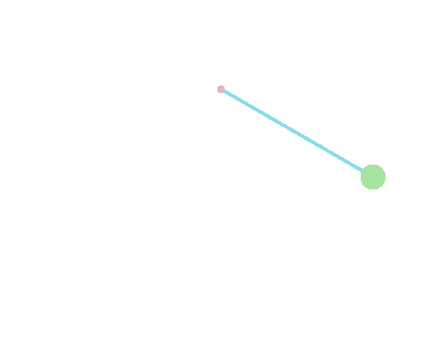

# Animated GIFs

`` plays back for real, looping, entirely on the
terminal's side -- once the frames are sent there's nothing left for
`slides` to do every tick.

---

# Simple pendulum

Generated with Julia (Plots.jl + GR): θ(t) = θ₀ cos(ωt), one frame per
render, transparent background, colors matching this theme.

