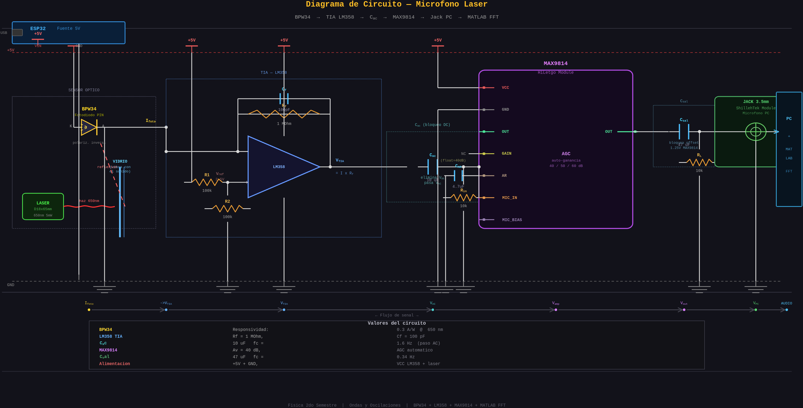
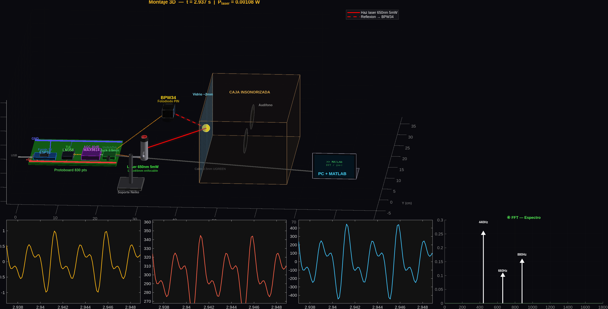
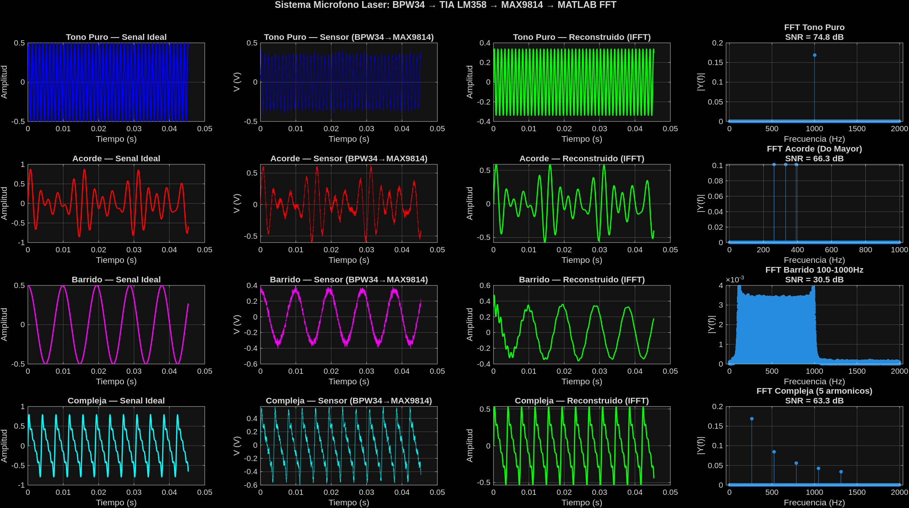
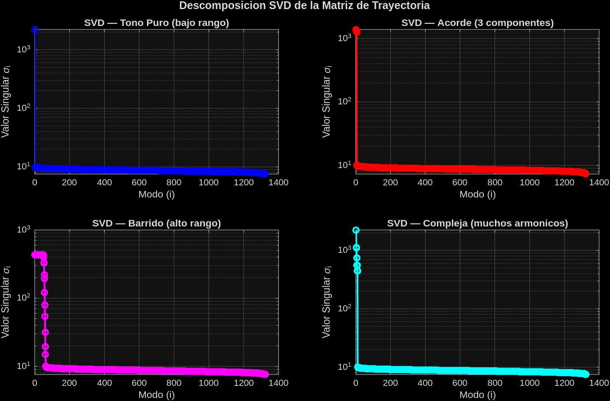

# Reconstrucción de Sonido con Láser y Fotosensor

### De la Teoría al Código

Un proyecto de Física II: ondas, transformadas de Fourier y álgebra lineal
para capturar y reconstruir audio con un haz láser y un fotosensor.

*Validado completamente en simulación MATLAB antes de construir el hardware.*

---

## ¿Puede un Rayo de Luz Transportar Sonido?

Pregunta de clase de física: si el sonido vibra el aire, ¿podría esa
vibración modular un haz de luz y recuperarse después?

**Sí.** El principio:

- El sonido dentro de una caja insonorizada hace vibrar un panel de vidrio
- Un láser de 650 nm apunta al vidrio; el reflejo modulado lo capta un fotodiodo BPW34
- La fotocorriente pasa por un TIA (LM358) → voltaje
- Un MAX9814 con AGC amplifica
- MATLAB digitaliza y reconstruye el audio original

---

## El modelo de la señal

$$V(t) = A \cdot \sin(2\pi f t) + \eta(t)$$

donde $\eta(t)$ es el ruido del sistema óptico-electrónico.

El reto: dado que $\eta(t)$ siempre existe, ¿cómo recuperamos
$A \cdot \sin(2\pi f t)$ con la mayor fidelidad posible?

Este es el resumen de la **fase de simulación completa en MATLAB** que
valida los algoritmos antes del hardware real.

---

## Fundamentos: Transformada de Fourier

Cualquier señal periódica se descompone como suma de senos y cosenos.
La DFT lo hace numéricamente:

$$X[k] = \sum_{n=0}^{N-1} x[n] \cdot e^{-j2\pi kn/N}$$

La **FFT** calcula la DFT en $O(N \log N)$ en vez de $O(N^2)$, y acá cumple
dos funciones:

1. **Identificar** qué frecuencias componen la señal capturada
2. **Filtrar** el ruido eliminando componentes espectrales débiles

---

## Fundamentos: Descomposición SVD

Conecta con *espacios vectoriales* del semestre. Dada una matriz de
trayectoria $M$ construida a partir de la señal:

$$M = U \cdot \Sigma \cdot V^T$$

Los valores singulares $\sigma_i$ en $\Sigma$ revelan cuántos "modos
independientes" necesita la señal para representarse.

> **Conexión con el curso:** el SVD es un cambio de base ortogonal. Las
> columnas de $U$ son la nueva base del espacio de la señal, y los valores
> singulares son las coordenadas de importancia de cada vector base — el
> mismo concepto de base ortonormal que vimos en clase.

---

## El Hardware

| Componente               | Función              | Parámetro clave                    |
|---------------------------|-----------------------|--------------------------------------|
| Láser 650nm 5mW           | Fuente de luz         | Enfocable, soporte Neiko ~30°       |
| BPW34 (fotodiodo PIN)     | Luz → corriente       | R = 0.3 A/W @ 650 nm                 |
| LM358 (TIA)               | Corriente → voltaje   | Rf = 10 kΩ, Cf = 100 pF              |
| MAX9814                   | Amplificador AGC      | Av = 40 dB                           |
| Jack 3.5mm                | Interfaz PC           | Entrada micrófono, breakout TRRS     |
| ESP32                     | Alimentación 5V       | Pin VIN → rail protoboard            |

El **BPW34** gana sobre un LDR por tiempo de respuesta: 20 ns frente a
~1 ms — audio hasta 20 kHz sin degradación del sensor.

---

## Diagrama del circuito



---

## Montaje experimental



La animación sincroniza la vibración del vidrio con las señales en tiempo
real en cada etapa del pipeline.

---

## Metodología: simulando el pipeline físico completo

No basta con sumar ruido gaussiano — el modelo simula la cadena física real:
generación → modulación óptica → BPW34 → TIA → MAX9814 → filtrado FFT →
reconstrucción → validación.

```matlab
function v_out = pipeline_sensor(audio, P_laser, mod_depth, ...
                                 R_bpw34, Rf_TIA, Av_MAX, ruido)
    % 1. Modulacion optica: el vidrio vibrante modula el reflejo
    P_luz  = P_laser * (1 + mod_depth * audio);

    % 2. BPW34: fotocorriente = responsividad x potencia + shot noise
    I_foto = R_bpw34 * P_luz + ruido * 1e-4 * randn(size(audio));

    % 3. TIA LM358: I -> V, eliminar offset DC
    V_tia  = I_foto * Rf_TIA;
    V_tia  = V_tia - mean(V_tia);

    % 4. MAX9814: amplificar y saturar (+-1.65V)
    V_max  = Av_MAX * V_tia;
    v_out  = max(-1.65, min(1.65, V_max));
end
```

El shot noise del BPW34 es de apenas **0.8%** de la señal, frente al 5%
típico de un LDR.

---

## Las cuatro señales de prueba

| Señal            | Frecuencias         | Por qué es interesante          |
|-------------------|-----------------------|-------------------------------------|
| Tono puro         | 1000 Hz               | Caso base, más simple               |
| Acorde Do Mayor   | 262 + 330 + 392 Hz    | Tres frecuencias simultáneas        |
| Barrido (chirp)   | 100 → 1000 Hz         | Frecuencia variable en el tiempo    |
| Señal compleja    | 262·k Hz, k=1..5      | Serie armónica, simula voz humana   |

---

## El algoritmo de reconstrucción

Máscara binaria sobre el espectro FFT: conserva componentes que superan el
10% del pico máximo, reconstruye con IFFT manteniendo **simetría
hermitiana** para obtener valores reales:

```matlab
function senial_rec = reconstruir_por_fft(senial_ruidosa)
    N        = length(senial_ruidosa);
    Y        = fft(senial_ruidosa);

    mag_pos  = abs(Y(1 : floor(N/2) + 1));
    umbral   = max(mag_pos) * 0.1;
    mascara_pos = double(mag_pos > umbral);

    mascara = zeros(N, 1);
    mascara(1 : floor(N/2) + 1)   = mascara_pos;
    mascara(floor(N/2)+2 : N)     = flipud(mascara_pos(2 : floor(N/2)));

    senial_rec = real(ifft(Y .* mascara));
end
```

> **Error que cometí:** usar `N/2` directo para indexar falla cuando `N`
> es impar. La solución: `floor(N/2)` en todos los índices, construyendo
> la simetría conjugada explícitamente.

---

## Resultados: pipeline completo



La columna "Reconstruido" recupera la forma de onda con fidelidad casi
indistinguible del original, a pesar del ruido visible en "Capturado".

---

## Métricas cuantitativas

| Señal     | Error RMS   | SNR (dB)     | Correlación | Resultado  |
|-----------|-------------|--------------|-------------|------------|
| Tono puro | 2.79 × 10⁻⁶ | **102.1 dB** | 1.0000      | Excelente  |
| Acorde    | 2.87 × 10⁻⁴ | **62.1 dB**  | 1.0000      | Excelente  |
| Barrido   | 1.06 × 10⁻² | **30.5 dB**  | 0.9996      | Muy bueno  |
| Compleja  | 3.00 × 10⁻⁴ | **63.1 dB**  | 1.0000      | Excelente  |

> Un SNR por encima de 20 dB ya es aceptable para voz; por encima de 40 dB
> es transparente para el oído humano. Este sistema: entre 30.5 y 102.1 dB.

---

## Análisis SVD



| Señal     | Varianza acumulada (5 modos) |
|-----------|-------------------------------|
| Tono puro | **99.0%** — casi toda la energía en 1–2 modos |
| Acorde    | **84.3%** — ~3 modos (uno por frecuencia)     |
| Barrido   | **9.3%** — energía muy distribuida            |
| Compleja  | **88.6%** — varios modos armónicos            |

El barrido necesita cientos de vectores singulares: ningún modo fijo
captura una frecuencia que cambia continuamente.

---

## Conclusiones

1. **El filtrado espectral FFT funciona** — SNR hasta 102.1 dB, correlación 1.0000 en 3 de 4 señales
2. **El barrido es el caso más difícil** — 30.5 dB revela el límite del filtro de umbral fijo; STFT o Wavelet serían mejores
3. **El SVD confirma la teoría** — rango efectivo refleja la complejidad de la señal
4. **El BPW34 supera al LDR** — shot noise de 0.8% vs 5%, se traduce en más SNR
5. **La simulación valida la arquitectura** antes de construir el hardware

---

## Próximos pasos

- **Montaje físico:** láser sobre soporte Neiko, BPW34 en tubo negro, protoboard 830 puntos
- **Primera captura real:** comparar SNR experimental vs. simulado (objetivo: >20 dB)
- **Señales de prueba:** tono puro → voz → música
- **Futuro:** STFT para mejorar la reconstrucción del chirp

El siguiente post documenta la construcción del hardware y la primera
captura real de audio.

---

# Gracias

*Física II — Ondas, Oscilaciones y Espacios Vectoriales*

Código completo: `github.com/Richard7987/Proyecto-Fisica-2do`
